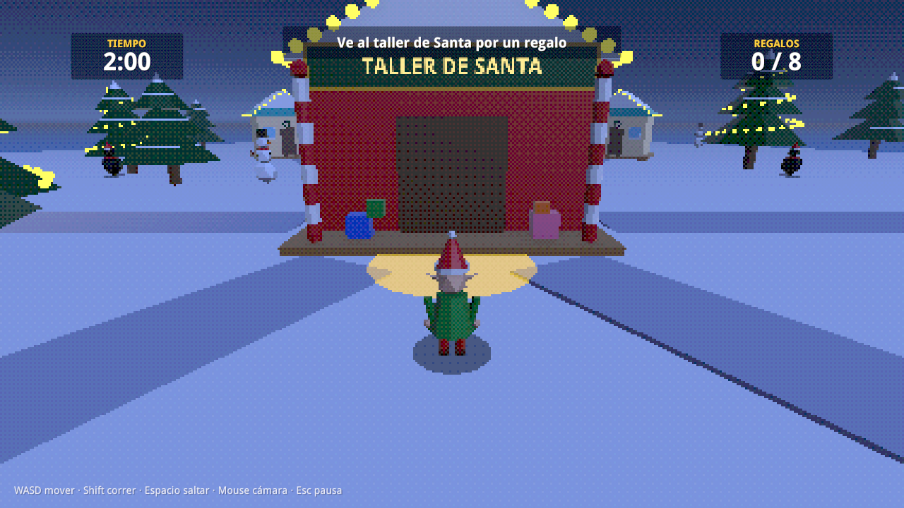
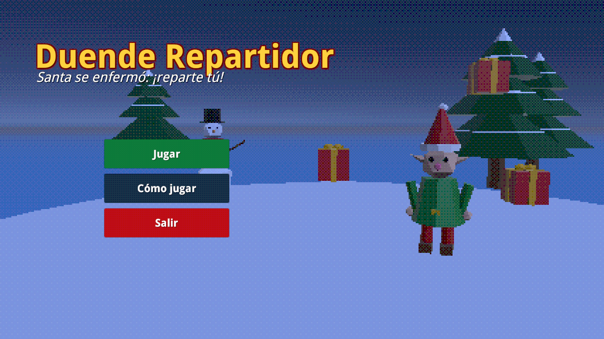
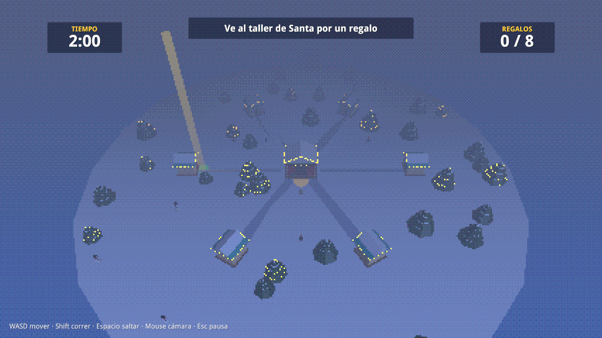
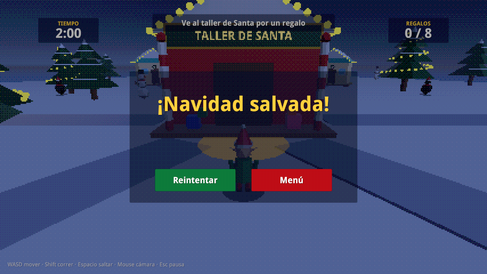

# 🎁 Duende Repartidor

Prototipo 3D en Unity con temática navideña y **estilo visual de PlayStation 1**.

Es nochebuena, está nevando y Santa amaneció con gripa. Tú eres su duende de confianza y tienes que repartir **8 regalos** por el pueblo antes de que amanezca, cuidándote de los pingüinos que se roban los regalos.



| Menú | Vista del pueblo | Final |
| --- | --- | --- |
|  |  |  |

## Cómo se juega

1. Ve al **taller de Santa** (la zona dorada frente al portón) para tomar un regalo.
2. Llévalo a la casa que tiene el **haz de luz**. La flecha dorada que flota junto al duende siempre apunta a tu siguiente objetivo.
3. Si un **pingüino** te alcanza mientras cargas un regalo, te lo roba y tienes que volver al taller.
4. Ganas al entregar 8 regalos y pierdes si se acaban los **2 minutos**.

| Acción | Teclado y mouse | Control |
| --- | --- | --- |
| Moverse | WASD o flechas | Stick izquierdo |
| Correr | Shift | — |
| Saltar | Espacio | A / Cruz |
| Cámara | Mouse | Stick derecho |
| Pausa | Esc | Start |

## Estilo PS1

- **Shader `Duende/PS1Lit`** (URP): los vértices se redondean a una rejilla de baja resolución (*vertex snapping*, el temblor característico), usa mapeo de textura afín, iluminación por vértice (Gouraud) y niebla.
- **`PS1Camera`**: el mundo 3D se renderiza a 240 líneas y se escala sin filtro; la UI queda a resolución completa.
- **Pase de pantalla completa `Duende/PS1Posterize`**: color de 15 bits (32 niveles por canal) con dithering Bayer 4×4.
- Sin sombras en tiempo real ni antialiasing; los personajes llevan sombras circulares.
- Modelos *low poly* hechos con código en Blender.

## Requisitos

- Unity **6000.3.27f1** (Unity 6.3) con URP, Input System y AI Navigation
- Blender 5.x (opcional, solo para regenerar los modelos)
- [Unity CLI](https://unity.com) (opcional, para los scripts de `Tools/`)

## Cómo está hecho

Las escenas no se arman a mano: un constructor de editor las genera desde código, así se pueden reproducir y revisar en Git.

- **Menú `Duende` en el Editor**:
  - *Construir todo*: configura URP, materiales, prefab del jugador y las escenas Game y MainMenu.
  - *Build ▸ Windows / Linux*: genera el ejecutable en `Builds/`.
  - *Tomar capturas de revisión*.
- **Desde la terminal, con el Editor cerrado**:
  ```bash
  blender --background --factory-startup --python Tools/Blender/generar_modelos.py   # modelos FBX
  Tools/construir.sh                                                                   # escenas
  unity test . --mode PlayMode                                                         # pruebas
  ```

```
Assets/
  Scripts/Core       GameManager, PS1Camera
  Scripts/Player     PlayerController, ThirdPersonCamera
  Scripts/Gameplay   GiftCarrier, Workshop, DeliveryHouse/Manager, PenguinAI, GuideArrow, ChristmasLights...
  Scripts/UI         HUD, MainMenu, PauseMenu, EndScreen
  Shaders/           PS1Lit, PS1Posterize
  Editor/            DuendeBuilder.* (constructor de escenas), DuendeCaptura, DuendeBuild
  Tests/PlayMode     13 pruebas del ciclo de juego, victoria y derrota, menús y pingüinos
Tools/Blender/       generar_modelos.py (duende, regalo, casa, taller, pino, muñeco de nieve, pingüino, flecha)
```

## Desarrollo

El trabajo se dividió en [issues de GitHub](../../issues?q=is%3Aissue), cada uno resuelto en su propio commit.
